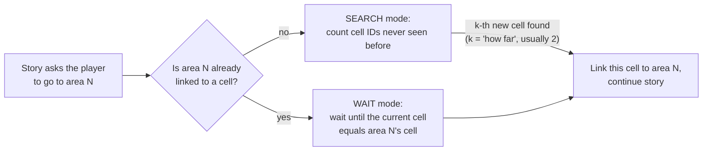

# The Journey

**A mobile location-based adventure game for Symbian / S60 (2004 – 2011)**

<p align="center">
  
  
  
</p>

*The Journey* was the world's first location-based mobile adventure game. You play an
infamous detective who is hired by a mysterious man. To make progress, you don't move a
character around on screen: you pick up your phone and walk through your own city.

The game came out before phones had GPS. It detects movement from the **cell IDs of the
GSM network**: when the phone registers with a new radio cell, you have moved. The game
remembers the cells where story locations were "found". Later in the story it can send
you back to a place you have already visited. For the showdown you have to return to the
bureau, the place where you started playing.

This repository archives the complete source code, graphics, the last released installer
(v1.40) and the bachelor thesis the game was written for. It's here for historical
reference. Building or installing a Symbian application today takes some effort; see
[Building](#building-historical) below.

Project website: <https://journey.andreasjakl.com/>

---

## History

| Year | Milestone |
|------|-----------|
| 2004 | First version, written for the bachelor thesis *"The Workflow of C++ Game-Development on a Series 60 Platform device"* at FH Hagenberg (today the University of Applied Sciences Upper Austria), Multimedia Technology and Design. Built for Series 60 phones of that time (screenshots in the thesis use the Siemens SX1 emulator skin). |
| 2006 – 2007 | Port to S60 3rd Edition (Symbian OS 9): platform security, data caging, scalable SVG graphics, the public `CTelephony` API instead of the undocumented GSM ETel API. |
| 2009 | Touch support for S60 5th Edition (Nokia 5800 XpressMusic), landscape layouts (e.g. Nokia N95, E90). |
| 2011 | v1.40: Symbian^3 support (Nokia N8), Russian translation. Last release. |

The game was followed by [*The Journey II*](https://journey2.andreasjakl.com/), a fully
interactive successor.

## How the location tracking works

The phone asks the network for the current cell ID every 5 seconds
(`CSysInfo` → `CTelephony::GetCurrentNetworkInfo()`). The location engine
(`CJourneyLocation`) runs in one of two modes:



Some details handle the quirks of cell-based positioning:

* **Distance through counting.** A new area isn't assigned to the first new cell. It goes
  to the *k*-th new cell (`SAreaInfo::iHowFar`), so the player has to walk a real distance
  and not just cross one cell border.
* **Border flicker.** Phones near a cell border often switch back and forth between cells
  without moving. If two story parts happen in the same area, the game doesn't check the
  location between them (`iPrevAreaNum`). The player can keep reading even if the cell
  changes.
* **Error states.** Offline mode, no GSM network and "cell ID = 0" each get their own
  in-game message instead of breaking the game.
* **Privacy.** Before first use, the game explains that it reads network cell IDs and
  asks for consent. Cell IDs are stored only in the app's private folder on the phone.

The emulator build (`__WINS__`) simulates a fixed cell ID so the game can be debugged on
a PC.

## Repository layout

```
.
├── source/                  Symbian C++ project (S60 3rd Ed. / 5th Ed. / Symbian^3)
│   ├── group/               Build files: bld.inf, Journey.mmp, SVG → MIF icon makefile
│   ├── inc/                 Headers and localisation (journey.l01 = English,
│   │                        .l03 = German, .l16 = Russian)
│   ├── src/                 Implementation
│   ├── data/                Resource files (.rss / .rls), application registration
│   ├── gfx/                 Scalable vector graphics (SVG-Tiny) of all scenes
│   └── sis/                 Installer package definition (.pkg), backup registration
├── release/                 Signed installer of v1.40 as it was distributed
│   ├── Journey.sis
│   ├── readme.txt
│   └── install.txt
├── docs/
│   └── bachelor-thesis-2004.pdf   Original thesis (2004)
└── LICENSE                  GNU GPL v3
```

### Architecture overview

| Layer | Classes | Role |
|-------|---------|------|
| Application framework | `CJourneyApplication`, `CJourneyDocument`, `CJourneyAppUi` | Standard S60 application skeleton; settings (ini file), delayed view switching |
| Views | `CJourneyVMenu`, `CJourneyVGame` | `CAknView`s for the title/menu screen and the game screen |
| Containers (UI) | `CJourneyCMenu`, `CJourneyCGame`, `CTextBox` | Custom full-screen drawing with a back buffer, resolution-independent layout, touch + key input, own text box with line breaking and paging |
| Game logic | `CJourneyEngine`, `CJourneyStory` | Game flow, story tables, savegame (`Progress.dat`) |
| Location | `CJourneyLocation`, `CSysInfo` | Area search/wait logic; asynchronous cell ID requests (active object) |

The layers talk to each other through observer interfaces (`MSearchCallback`,
`MLocationCallback`, `MCommInterface`).

## Playing the original release

`release/Journey.sis` is the original v1.40 installer for S60 3rd Edition, S60 5th
Edition and Symbian^3 phones (for example the Nokia N95, E90, 5800 XpressMusic and N8).
See [`release/install.txt`](release/install.txt). The installer was signed when it was
released; that certificate has most likely expired by now. A common workaround on
these phones was to set the phone's date back before installing.

To play, you need a phone with a SIM card and GSM/UMTS network coverage. The game only
works outdoors, while you walk around.

## Building (historical)

These are the tools that were used for the 2011 build. They are no longer distributed
officially:

* S60 3rd Edition FP1 (or later) SDK, or the Symbian^3 SDK
* Carbide.c++ 2.x, or the command-line toolchain (Perl, GCCE / ARM RVCT)

```bat
cd source\group
bldmake bldfiles
abld build gcce urel
cd ..\sis
makesis Journey.pkg Journey.sis
signsis Journey.sis Journey.sisx <certificate> <key>
```

The `.pkg` file uses Carbide variables (`$(EPOCROOT)`, `$(PLATFORM)`, `$(TARGET)`).
Outside Carbide, replace them by hand. The application needs the `ReadDeviceData`
capability to read the cell ID, so a self-signed certificate is not enough. This
capability was originally granted through Symbian Signed.

* UID: `0x20009AEB`
* Languages: English (01), German (03), Russian (16)

## Changes since v1.40

The source code is the v1.40 release with two small bug fixes from 2026. The installer
in `release/` is the original, unchanged v1.40 build.

* `CSysInfo` now cancels an outstanding cell ID request before it is destroyed.
  Previously, leaving the game screen while a request was pending could crash the app.
* `CJourneyAppUi` now deletes the timer of a previous view switch. Previously, every
  additional *Start game* or *Continue game* leaked one `CPeriodic`. The timer is also
  stopped before the view switch, so a failed switch isn't retried every millisecond.

## License

Copyright © 2004 – 2011 Andreas Jakl

The Journey is free software, released under the GNU General Public License. The source
file headers say "version 2 or (at your option) any later version"; the release was
distributed with version 3 of the license, which is included in [LICENSE](LICENSE).

Parts of `bitmapmethods.cpp/.h` are based on Nokia Series 60 example code.

## Links

* Project website: <https://journey.andreasjakl.com/>
* The Journey II: <https://journey2.andreasjakl.com/>
* Author: <https://www.andreasjakl.com/>
